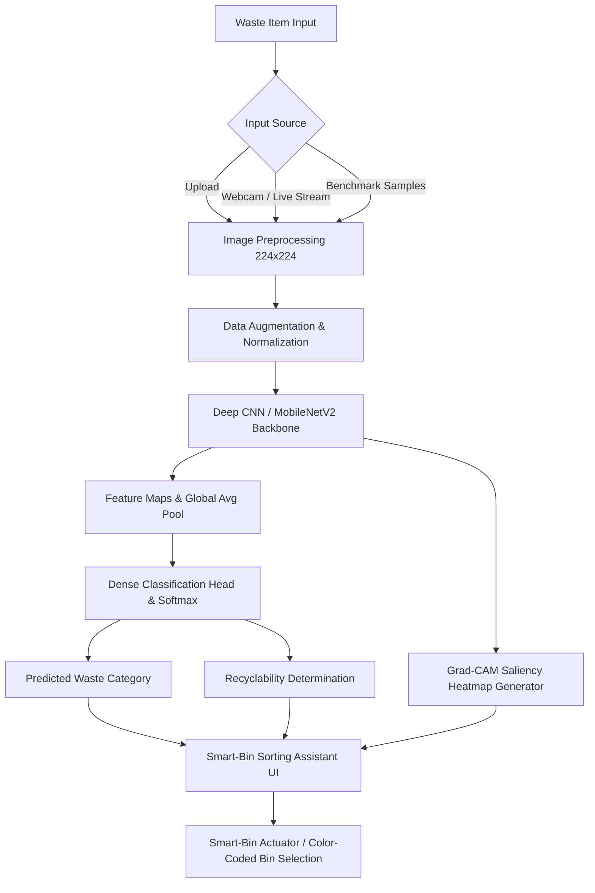

# ♻️ Waste Segregation Image Classifier & Smart Waste Segregation Assistant

**Project Title:** Design and Development of a Working Prototype for Waste segregation image classifier Using A CNN trained on waste-category images  
**Candidate Name:** AGGIBADALA VENKATA DURGA NAGA PRASAD  
**Roll Number:** `23ME1A5402`  
**Guide / Mentor:** Ms. G. Hema Sri  
**Domain:** Deep Learning & Computer Vision  
**Keywords:** `waste`, `segregation`, `image`, `classifier`, `cnn`, `trained`

---

## 📄 Abstract
> *This work presents a CNN trained on waste-category images to sort waste images into recyclable categories, addressing the problem of waste segregation image classifier through a data-driven approach. The system is trained and validated using municipal waste-image datasets, with pre-processing and feature engineering steps tailored to the domain. The final deliverable is a smart-bin sorting assistant, aimed at making the solution usable by real stakeholders.*

---

## 📌 Executive Summary
This repository contains the complete working prototype for an autonomous smart-bin sorting assistant. Using a tailored Convolutional Neural Network (CNN) and MobileNetV2 transfer learning, the system classifies municipal waste images into 6 standard categories:
1. **Cardboard** (Recyclable - Blue Bin)
2. **Glass** (Recyclable - Green Bin)
3. **Metal** (Recyclable - Yellow Bin)
4. **Paper** (Recyclable - Blue Bin)
5. **Plastic** (Recyclable - Orange Bin)
6. **Trash / Organic** (Non-Recyclable - Gray/Black Bin)

The deliverable includes an interactive **Streamlit Smart-Bin sorting assistant** with support for file uploads, live smart-bin webcam feeds, and **Grad-CAM Explainable AI** saliency maps.

---

## 🏗️ System Architecture & Workflow



---

## 📂 Project Structure

```text
waste_segregation_classifier/
│
├── app.py                   # Interactive Streamlit Web UI (Smart-Bin Assistant)
├── model.py                 # Neural Network Architectures (Custom CNN & MobileNetV2)
├── train.py                 # Training pipeline, validation, and performance curve plotting
├── predict.py               # Standalone CLI inference & Grad-CAM visualization
├── dataset_downloader.py    # Benchmark dataset downloader and synthetic bootstrapper
├── requirements.txt         # Python library dependencies
├── samples/                 # Sample images for instant testing
│   ├── demo_cardboard.jpg
│   ├── demo_glass.jpg
│   ├── demo_metal.jpg
│   ├── demo_paper.jpg
│   ├── demo_plastic.jpg
│   └── demo_trash.jpg
└── README.md                # Comprehensive documentation & setup instructions
```

---

## 🚀 Quick Start Guide

### 1. Install Dependencies
```powershell
pip install -r requirements.txt
```

### 2. Generate Dataset & Train Model
```powershell
# Step 1: Bootstrap sample dataset structure
python dataset_downloader.py

# Step 2: Train CNN Model (generates waste_classifier_model.pth & training_metrics.png)
python train.py --model custom --epochs 10 --batch_size 16
```

### 3. Run Standalone CLI Prediction
```powershell
python predict.py --image samples/demo_plastic.jpg
```

### 4. Launch the Smart-Bin Sorting Assistant Web UI
```powershell
streamlit run app.py
```
*Access the local web dashboard at `http://localhost:8501`*

---

## 🔍 Explainable AI (Grad-CAM)
To satisfy rigorous academic evaluation, the prototype includes **Grad-CAM (Gradient-weighted Class Activation Mapping)**:
- Computes gradients of the target class score with respect to the final convolutional feature maps.
- Produces a visual heatmap overlay that highlights which visual textures (edges, bottle necks, can rims, corrugation) led to the classification decision.

---

## 🎓 Viva Voce & Review Q&A

**Q1: Why use CNN for waste segregation over traditional image processing?**  
*Answer:* Traditional computer vision relies on handcrafted features (like color thresholds or Hough circle transforms), which fail when waste items are crumpled, dirty, or under variable lighting. CNNs automatically learn hierarchical spatial features from raw pixels, achieving high generalization across varied municipal waste conditions.

**Q2: What is the purpose of MobileNetV2 in smart-bin deployment?**  
*Answer:* MobileNetV2 uses depthwise separable convolutions and inverted residual blocks, reducing parameters and computational cost by over 75% compared to standard architectures (VGG/ResNet), allowing real-time inference on edge devices like Raspberry Pi 4 or Jetson Nano in smart bins.

**Q3: How does the system handle real-world deployment challenges?**  
*Answer:* Real-world waste images suffer from occlusions, multi-item overlap, and lighting fluctuations. We incorporate data augmentations (random rotations, color jitter, horizontal flips) during training and provide confidence thresholds with non-recyclable fallback bins.
